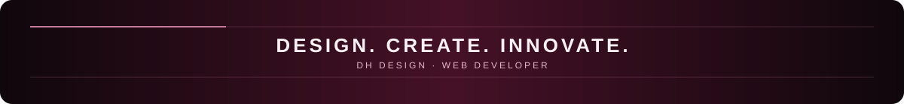

 

---

## `01` — About Me

Hi, I'm **Dhiraj Mali**, a web developer building modern and responsive web experiences under **DH DESIGN**.

- **Primary focus:** Web Development
- **Currently studying:** BCA — 3rd Semester
- **Creative side:** Graphic Design and 3D Typography
- **Brand tagline:** *Design. Create. Innovate.*

I enjoy turning ideas into clean, useful digital experiences and continuously improving my development skills.

## `02` — Tech Stack

  
  
  
  
  
  
  

## `03` — Featured Projects

> Add your project details here when you're ready. These sections are intentionally left as placeholders.

<!-- PROJECTS: Add a project by replacing the placeholder below. -->
| Project | Description | Repository | Live Demo |
|---|---|---|---|
| **Project 01** | Add a short description | Add repository link | Add live link |
| **Project 02** | Add a short description | Add repository link | Add live link |
| **Project 03** | Add a short description | Add repository link | Add live link |

## `04` — GitHub Activity

The activity graph below uses your GitHub username and displays activity supplied by the external graph service. If it fails to load, your GitHub contribution calendar is still available directly on your profile.

## `05` — Connect

- **GitHub:** [@dhirajmali03](https://github.com/dhirajmali03)
- **Instagram:** [@dhirajj_03_](https://www.instagram.com/dhirajj_03_/)
- **Email:** [dm5316998@gmail.com](mailto:dm5316998@gmail.com)
- **Live websites:** Add your links here when ready.

---

  
  Built with care by Dhiraj Mali · DH DESIGN

